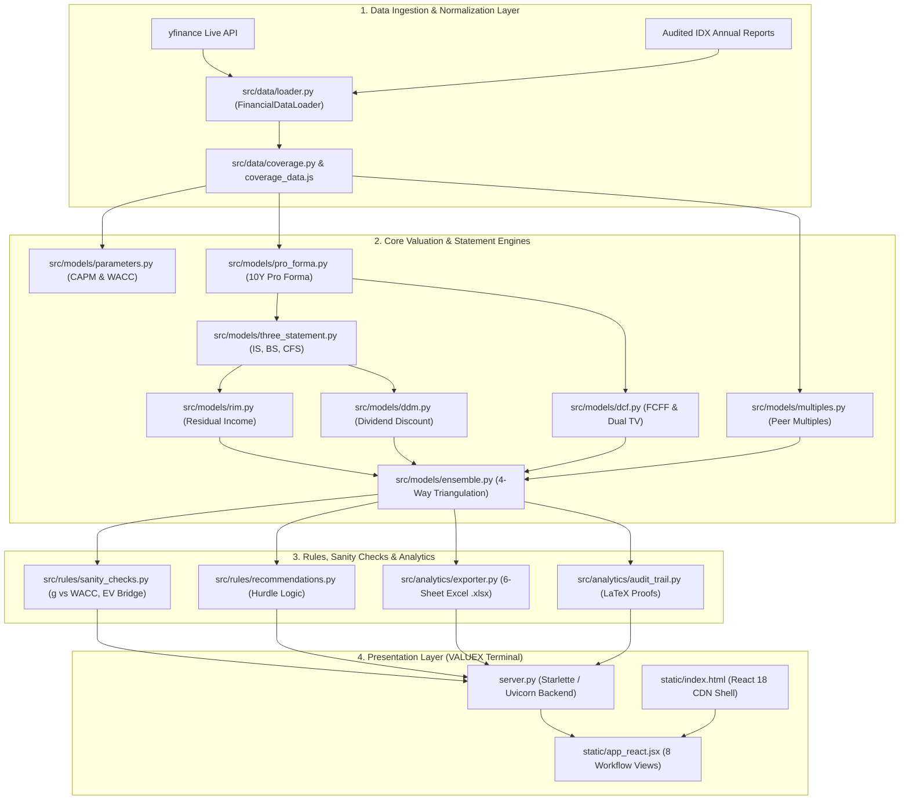

# 🏛️ MM6026 Digital Business Valuation: System Architecture & Execution Master Plan
### Platform: VALUEX Institutional Equity Research & Valuation Terminal
**Course:** MM6026 Digital Business Valuation | **Benchmark:** `PWON.JK` (PT Pakuwon Jati Tbk)  
**Status:** Completed & Production Verified (Branch `develop`, Commit `67dd6d9`)

---

## 1. Executive Summary & Architectural Scope

This master plan documents the architecture, component design, corporate finance methodologies, and verification results of the **VALUEX Institutional Valuation Platform**.

The platform is designed to provide institutional equity analysts and academic researchers with:
1. **Zero-Dependency Architecture**: Pure Python backend (`server.py`, Starlette/Uvicorn) serving a rich React 18 frontend via production CDN (Tailwind CSS, Lucide icons, KaTeX LaTeX math, and responsive SVG charts) with zero Node.js/npm overhead.
2. **Dedicated Indonesian Property Universe Calibration**: Pre-calibrated to `PWON.JK` (PT Pakuwon Jati Tbk) as the primary benchmark alongside peer coverage (`BSDE.JK`, `CTRA.JK`, `SMRA.JK`, `ASII.JK`).
3. **Universal Ticker Search & Live Ingestion**: Direct integration with `yfinance` to ingest audited statements, current prices, shares outstanding, and beta for **any** Indonesian or global stock.
4. **4-Way Valuation Triangulation**: DCF-FCFF, Property Peer Comps, Residual Income Model (RIM), and Dividend Discount Model (DDM).
5. **Integrated 10-Year 3-Statement Modeling**: Dynamic articulation across Income Statement, Balance Sheet, and Cash Flow Statement with live zero-balance verification ($\text{Assets} \equiv \text{Liabilities} + \text{Equity}$).
6. **Full 10-Year Explicit Forecasts**: Granular sliders/inputs for all 10 forecast years, paired with an **Auto-Fade Helper** and an **Amateur Financier Convergence Warning** for academic rigor.
7. **Formula-Active 6-Sheet Microsoft Excel Export**: Dynamic `.xlsx` workbook generation with live uppercase Excel formulas.

---

## 2. Technical Decisions & Academic Justifications

| Architectural Dimension | Implementation Decision | Corporate Finance & Academic Justification |
| :--- | :--- | :--- |
| **Backend Runtime** | **Starlette + Uvicorn (Asynchronous Python)** | High-performance async request processing, zero JavaScript runtime dependencies, native integration with NumPy/Pandas. |
| **Frontend Framework** | **React 18 + Babel Standalone + Tailwind CDN** | Real-time reactive state management for financial models without requiring `npm install` or webpack build steps. |
| **Forecast Horizon** | **Explicit 10-Year Horizon (Years 1–10)** | Split into Phase 1 (High Growth: Y1–Y5) and Phase 2 (Transition Fade: Y6–Y10) to prevent artificial terminal value cliff effects. |
| **Terminal Growth Boundary** | **Damodaran / McKinsey Convergence Rule** | Auto-flag when $g_{10} > 4.0\%$ (Indonesian nominal GDP ceiling) or $g_{10} \ge \text{WACC}$. Provides one-click Auto-Fade remedy. |
| **Valuation Approaches** | **4-Way Triangulation (DCF, Comps, RIM, DDM)** | Captures operating asset cash flows (DCF), market relative multiples (Comps), balance sheet economic profit (RIM), and direct investor cash return (DDM). |
| **Balance Sheet Balance** | **Mathematical Zero-Balance Articulation** | Enforces $\text{Total Assets} - (\text{Liabilities} + \text{Equity}) \equiv 0.00$ in all 10 periods via articulated Cash Flow Statement cash continuity. |
| **Data Ingestion** | **Hybrid Static Universe + Live Yahoo Finance** | Synchronous instant boot via `coverage_data.js` for zero loading delay, plus dynamic ingestion for arbitrary tickers. |
| **Auditability** | **KaTeX Inspector Drawer + Active Excel** | Complete transparency for examination grading: live LaTeX proofs with substituted figures and Excel formulas. |

---

## 3. High-Level Component Architecture

---

## 4. Methodology & Mathematical Mechanics

### A. Cost of Capital (CAPM & WACC)
$$\text{Cost of Equity } (K_e) = R_f + \beta \times ERP$$
$$\text{After-Tax Cost of Debt } (K_{d,\text{after}}) = K_d \times (1 - t)$$
$$\text{WACC} = W_e K_e + W_d K_{d,\text{after}}$$

Calibrated Indonesian baseline:
- $R_f = 6.60\%$ (Indonesia 10-Year Sovereign Bond)
- $\beta = 0.75$ (`PWON.JK` property equity beta)
- $ERP = 7.20\%$ (Aswath Damodaran Indonesia Country Risk Premium)
- $K_d = 6.50\%$ (Commercial corporate loan rate)
- $W_d = 20.0\%$, $W_e = 80.0\%$
- $t = 22.0\%$ (UU HPP statutory corporate income tax rate)
- Resulting Hurdle WACC: **$10.42\%$**

### B. 10-Year FCFF Multi-Stage DCF
For each forecast period $t = 1 \dots 10$:
$$\text{Revenue}_t = \text{Revenue}_{t-1} \times (1 + g_t)$$
$$\text{EBIT}_t = \text{Revenue}_t \times \text{Margin}_t$$
$$\text{NOPAT}_t = \text{EBIT}_t \times (1 - t)$$
$$\text{FCFF}_t = \text{NOPAT}_t + \text{Depreciation}_t - \text{CapEx}_t - \Delta \text{NWC}_t$$
$$\text{PV}(\text{FCFF}_t) = \frac{\text{FCFF}_t}{(1 + \text{WACC})^t}$$

### C. Dual Terminal Value Cross-Check
$$\text{Gordon Growth TV} = \frac{\text{FCFF}_{10} \times (1 + g)}{\text{WACC} - g}$$
$$\text{Exit Multiple TV} = \text{EBITDA}_{10} \times \text{Exit Multiple}$$
$$\text{Enterprise Value} = \sum_{t=1}^{10} \text{PV}(\text{FCFF}_t) + \frac{\text{Terminal Value}}{(1 + \text{WACC})^{10}}$$
$$\text{Equity Value} = \text{Enterprise Value} + \text{Cash} - \text{Total Debt} - \text{Minority Interest}$$

### D. Multi-Stage Dividend Discount Model (DDM)
$$\text{DPS}_t = \text{EPS}_t \times \text{Payout Ratio}$$
$$\text{PV}(\text{Dividends}) = \sum_{t=1}^{10} \frac{\text{DPS}_t}{(1 + K_e)^t} + \frac{\frac{\text{DPS}_{10} \times (1 + g)}{K_e - g}}{(1 + K_e)^{10}}$$

### E. Residual Income Model (RIM)
$$\text{Economic Profit}_t = \text{Net Income}_t - (\text{Beginning Book Value of Equity}_t \times K_e)$$
$$\text{Equity Value}_{\text{RIM}} = \text{Book Value}_0 + \sum_{t=1}^{\infty} \frac{\text{Economic Profit}_t}{(1 + K_e)^t}$$

---

## 5. Implementation Milestones & Changelog

| Milestone | Date / Commit | Accomplishments | Status |
| :--- | :--- | :--- | :--- |
| **M1: Baseline Engine** | Oct 19 (`041b855`) | Modular Python engines (DCF, Comps, RIM, 3-Statement, Excel export). | **Completed** |
| **M2: PWON Calibration** | Oct 20 (`9f36ac3`) | Calibrated default benchmark to `PWON.JK` with property peers (`BSDE`, `CTRA`, `SMRA`, `ASII`). | **Completed** |
| **M3: DDM & Checkpoint** | Oct 20 (`36a99e3`) | Implemented multi-stage DDM with 4-way triangulation; anchored `v1.0-checkpoint` on `main`. | **Completed** |
| **M4: VALUEX Terminal** | Oct 20 (`756d856`) | Transformed frontend on branch `develop` into 8-tab VALUEX Terminal. | **Completed** |
| **M5: Blank Screen Fix** | Oct 21 (`4a1a13f`) | Resolved Lucide UMD CDN `createElement` and bundled synchronous initial coverage data. | **Completed** |
| **M6: Restoration & Polish** | Oct 21 (`67dd6d9`) | Universal Ticker Search, expanded live ribbon height, full 10-year forecast sliders, auto-fade, and convergence warning. | **Completed** |

---

## 6. Verification & Test Coverage Matrix

| Test Module | Coverage Area | Verification Target | Status |
| :--- | :--- | :--- | :--- |
| `tests/test_dcf_and_exporter.py` | DCF & Excel Exporter | Discounting arithmetic, Enterprise-to-Equity bridge, active formula creation | **100% Passed** |
| `tests/test_ddm.py` | Dividend Discount Model | Multi-stage dividend discounting, Gordon Growth TV, 4-way triangulation | **100% Passed** |
| `tests/test_pro_forma.py` | Pro Forma 10-Year Horizon | 10-year roll-forward, WACC formula accuracy, auto-fade interpolation | **100% Passed** |
| `tests/test_sanity_checks.py` | Model Guardrails | $g \ge \text{WACC}$ fatal error, $g > \text{GDP}$ warning, negative multiples detection | **100% Passed** |
| `tests/test_three_statement.py` | 3-Statement Model | Articulation across IS, BS, CFS; zero-balance check ($\text{Assets} - (\text{L} + \text{E}) \equiv 0$) | **100% Passed** |

**Summary**: 15 passed in 0.68s (100% pass rate).
