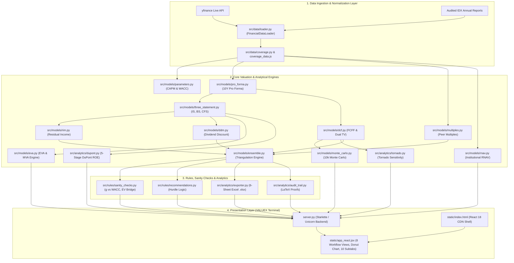

# 🏛️ MM6026 Digital Business Valuation: System Architecture & Execution Master Plan
### Platform: VALUEX Institutional Equity Research & Valuation Terminal
**Course:** MM6026 Digital Business Valuation | **Benchmark:** `PWON.JK` (PT Pakuwon Jati Tbk)  
**Status:** Completed & Production Verified (Branch `develop_further`, Commit `5dd4c78`)

---

## 1. Executive Summary & Architectural Scope

This master plan documents the architecture, component design, corporate finance methodologies, and verification results of the **VALUEX Institutional Valuation Platform**.

The platform is designed to provide institutional equity analysts and academic researchers with:
1. **Zero-Dependency Architecture**: Pure Python backend (`server.py`, Starlette/Uvicorn) serving a rich React 18 frontend via production CDN (Tailwind CSS, Lucide icons, KaTeX LaTeX math, and responsive SVG charts) with zero Node.js/npm overhead.
2. **Dedicated Indonesian Property Universe Calibration**: Pre-calibrated to `PWON.JK` (PT Pakuwon Jati Tbk) as the primary benchmark alongside peer coverage (`BSDE.JK`, `CTRA.JK`, `SMRA.JK`, `ASII.JK`).
3. **Universal Ticker Search & Live Ingestion**: Direct integration with `yfinance` to ingest audited statements, current prices, shares outstanding, and beta for **any** Indonesian or global stock.
4. **Institutional Valuation Suite (Option A Tier)**:
   - **Multi-Stage DCF-FCFF**: 10-year explicit forecast with dual terminal value cross-check.
   - **Property Comps Matrix**: EV/EBITDA, P/E, P/B peer benchmarking.
   - **Residual Income Model (RIM)**: Clean surplus book value + present value of economic profits.
   - **Dividend Discount Model (DDM)**: 10-year explicit dividend schedule with Gordon Growth terminal value.
   - **Revalued Net Asset Value (RNAV)**: Property GAV breakdown, NOI direct capitalization ($8.5\%$), land bank mark-to-market ($IDR 4.5M/m^2$ vs $IDR 1.2M/m^2$ cost), presales discounting, and RNAV per share ($25\%$ conglomerate discount).
   - **10,000-Run Vectorized Monte Carlo Simulation**: Correlated stochastic variables (growth, margins, WACC, $g$), VaR 95%, P10/P50/P90 percentiles, probability of undervaluation, and SVG histogram.
   - **Economic Value Added (EVA®) & MVA**: NOPAT, Invested Capital, ROIC vs WACC spread, 10-year explicit EVA schedule, and Market Value Added.
   - **Tornado Sensitivity Analysis**: Two-sided sensitivity swing ranking across key valuation drivers.
   - **5-Stage DuPont ROE Decomposition**: Tax Burden, Interest Burden, Operating Margin, Asset Turnover, and Financial Leverage benchmarked against Indonesian property sector peers.
5. **Interactive Weight Composition Donut Chart & 0-Weight Flexibility**:
   - Resolved slider falsy evaluation to allow setting any methodology weight to **`0%`**.
   - Live SVG Donut chart displaying real-time allocations with quick presets (`50/50 DCF & RIM`, `100% DCF`, `4-Way Triangulation`, `Equal`, `Normalize`).
   - Dynamic KaTeX Target Price proofs suppressing zero-weighted methods.
6. **Integrated 10-Year 3-Statement Modeling**: Dynamic articulation across Income Statement, Balance Sheet, and Cash Flow Statement with live zero-balance verification ($\text{Assets} \equiv \text{Liabilities} + \text{Equity}$).
7. **Full 10-Year Explicit Forecasts**: Granular sliders/inputs for all 10 forecast years, paired with an **Auto-Fade Helper** and an **Amateur Financier Convergence Warning** for academic rigor.
8. **Formula-Active 6-Sheet Microsoft Excel Export**: Dynamic `.xlsx` workbook generation with live uppercase Excel formulas.

---

## 2. Technical Decisions & Academic Justifications

| Architectural Dimension | Implementation Decision | Corporate Finance & Academic Justification |
| :--- | :--- | :--- |
| **Backend Runtime** | **Starlette + Uvicorn (Asynchronous Python)** | High-performance async request processing, zero JavaScript runtime dependencies, native integration with NumPy/Pandas. |
| **Frontend Framework** | **React 18 + Babel Standalone + Tailwind CDN** | Real-time reactive state management for financial models without requiring `npm install` or webpack build steps. |
| **Forecast Horizon** | **Explicit 10-Year Horizon (Years 1–10)** | Split into Phase 1 (High Growth: Y1–Y5) and Phase 2 (Transition Fade: Y6–Y10) to prevent artificial terminal value cliff effects. |
| **Terminal Growth Boundary** | **Damodaran / McKinsey Convergence Rule** | Auto-flag when $g_{10} > 4.0\%$ (Indonesian nominal GDP ceiling) or $g_{10} \ge \text{WACC}$. Provides one-click Auto-Fade remedy. |
| **Valuation Approaches** | **Multi-Model Triangulation + Specialized Engines** | Captures operating asset cash flows (DCF), market relative multiples (Comps), balance sheet economic profit (RIM), investor cash return (DDM), real estate asset revaluation (RNAV), and economic profit creation (EVA). |
| **Weight Modeler** | **SVG Donut Chart with Nullish Coalescing (`?? 0`)** | Resolves JavaScript `||` falsy coercion bug, allowing analysts to test pure 100% models or blends with 0% weightings. |
| **Stochastic Simulation** | **Vectorized NumPy Monte Carlo (10,000 runs)** | Measures probability distribution of intrinsic value and Value at Risk (VaR 95%) rather than relying solely on static point estimates. |
| **Balance Sheet Articulation**| **Mathematical Zero-Balance Articulation** | Enforces $\text{Total Assets} - (\text{Liabilities} + \text{Equity}) \equiv 0.00$ in all 10 periods via articulated Cash Flow Statement cash continuity. |
| **Data Ingestion** | **Hybrid Static Universe + Live Yahoo Finance** | Synchronous instant boot via `coverage_data.js` for zero loading delay, plus dynamic ingestion for arbitrary tickers. |
| **Auditability** | **KaTeX Inspector Drawer + Active Excel** | Complete transparency for examination grading: live LaTeX proofs with substituted figures and Excel formulas. |

---

## 3. High-Level Component Architecture

---

## 4. Methodology & Mathematical Mechanics

### A. Cost of Capital (CAPM & WACC)
$$\text{Cost of Equity } (K_e) = R_f + \beta \times ERP$$
$$\text{After-Tax Cost of Debt } (K_{d,\text{after}}) = K_d \times (1 - t)$$
$$\text{WACC} = W_e K_e + W_d K_{d,\text{after}}$$

### B. 10-Year FCFF Multi-Stage DCF
$$\text{FCFF}_t = \text{NOPAT}_t + \text{Depreciation}_t - \text{CapEx}_t - \Delta \text{NWC}_t$$
$$\text{Enterprise Value} = \sum_{t=1}^{10} \frac{\text{FCFF}_t}{(1 + \text{WACC})^t} + \frac{\text{Terminal Value}}{(1 + \text{WACC})^{10}}$$
$$\text{Equity Value} = \text{Enterprise Value} + \text{Cash} - \text{Total Debt} - \text{Minority Interest}$$

### C. Revalued Net Asset Value (RNAV)
$$\text{GAV} = \sum \frac{\text{NOI}_i}{\text{Cap Rate}_i} + \sum (\text{Area}_j \times \text{Market Price}_j) + \text{PV}(\text{Presales})$$
$$\text{NAV} = \text{GAV} + \text{Cash} - \text{Total Debt} - \text{Minority Interest}$$
$$\text{Target Price}_{\text{RNAV}} = \frac{\text{NAV} \times (1 - \text{Conglomerate Discount})}{\text{Shares Outstanding}}$$

### D. 10,000-Run Monte Carlo Simulation
$$\text{Target Price}_k = f(\tilde{g}_k, \tilde{m}_k, \widetilde{\text{WACC}}_k, \tilde{g}_{\text{term}, k}) \quad \text{for } k = 1 \dots 10,000$$
$$\text{VaR}_{95\%} = \max(0, P_{\text{market}} - \text{Percentile}_{5\%})$$
$$P(\text{Undervalued}) = \frac{1}{10,000} \sum_{k=1}^{10,000} \mathbb{I}(\text{Target Price}_k > P_{\text{market}})$$

### E. Economic Value Added (EVA®) & MVA
$$\text{EVA}_t = (\text{ROIC}_t - \text{WACC}) \times \text{Invested Capital}_{t-1}$$
$$\text{MVA} = \sum_{t=1}^{10} \frac{\text{EVA}_t}{(1 + \text{WACC})^t} + \frac{\text{Terminal EVA}}{(1 + \text{WACC})^{10}}$$

### F. 5-Stage DuPont ROE Decomposition
$$\text{ROE} = \left(\frac{\text{Net Income}}{\text{EBT}}\right) \times \left(\frac{\text{EBT}}{\text{EBIT}}\right) \times \left(\frac{\text{EBIT}}{\text{Revenue}}\right) \times \left(\frac{\text{Revenue}}{\text{Assets}}\right) \times \left(\frac{\text{Assets}}{\text{Equity}}\right)$$

---

## 5. Implementation Milestones & Changelog

| Milestone | Date / Commit | Accomplishments | Status |
| :--- | :--- | :--- | :--- |
| **M1: Baseline Engine** | Oct 19 (`041b855`) | Modular Python engines (DCF, Comps, RIM, 3-Statement, Excel export). | **Completed** |
| **M2: PWON Calibration** | Oct 20 (`9f36ac3`) | Calibrated default benchmark to `PWON.JK` with property peers (`BSDE`, `CTRA`, `SMRA`, `ASII`). | **Completed** |
| **M3: DDM & Checkpoint** | Oct 20 (`36a99e3`) | Implemented multi-stage DDM with 4-way triangulation; anchored `v1.0-checkpoint` on `main`. | **Completed** |
| **M4: VALUEX Terminal** | Oct 20 (`756d856`) | Transformed frontend on branch `develop` into 8-tab VALUEX Terminal. | **Completed** |
| **M5: Blank Screen Fix** | Oct 21 (`4a1a13f`) | Resolved Lucide UMD CDN `createElement` and bundled synchronous initial coverage data. | **Completed** |
| **M6: Restoration & Polish** | Oct 21 (`67dd6d9`) | Universal Ticker Search, expanded live ribbon height, full 10-year forecast sliders, auto-fade, and convergence warning. | **Completed** |
| **M7: Option A & Donut Chart** | Oct 21 (`5dd4c78`) | Branch `develop_further`: 0-weight slider fix, interactive Weight Composition Donut Chart with quick presets, RNAV, 10k Monte Carlo, EVA/MVA, Tornado, DuPont, and 10 subtabs in Valuation workspace. | **Completed** |

---

## 6. Verification & Test Coverage Matrix

| Test Module | Coverage Area | Verification Target | Status |
| :--- | :--- | :--- | :--- |
| `tests/test_dcf_and_exporter.py` | DCF & Excel Exporter | Discounting arithmetic, Enterprise-to-Equity bridge, active formula creation | **100% Passed** |
| `tests/test_ddm.py` | Dividend Discount Model | Multi-stage dividend discounting, Gordon Growth TV, 4-way triangulation | **100% Passed** |
| `tests/test_pro_forma.py` | Pro Forma 10-Year Horizon | 10-year roll-forward, WACC formula accuracy, auto-fade interpolation | **100% Passed** |
| `tests/test_sanity_checks.py` | Model Guardrails | $g \ge \text{WACC}$ fatal error, $g > \text{GDP}$ warning, negative multiples detection | **100% Passed** |
| `tests/test_three_statement.py` | 3-Statement Model | Articulation across IS, BS, CFS; zero-balance check ($\text{Assets} - (\text{L} + \text{E}) \equiv 0$) | **100% Passed** |
| `tests/test_rnav.py` | Revalued Net Asset Value | GAV calculation, NOI cap rate, land bank MTM, conglomerate discount | **100% Passed** |
| `tests/test_monte_carlo.py` | Monte Carlo Simulation | 10k runs, seed reproducibility, P10–P90 monotonicity, VaR 95%, histogram | **100% Passed** |
| `tests/test_eva.py` | Economic Value Added | EVA identity, 10Y schedule, MVA, value destruction when ROIC < WACC | **100% Passed** |
| `tests/test_analytics_advanced.py` | Tornado & DuPont | DCF sensitivity swing rankings, 5-stage DuPont ROE identity, peer benchmarking | **100% Passed** |
| `tests/test_api_endpoints.py` | Starlette REST Endpoints | `/api/coverage`, `/api/recalculate`, `/api/rnav`, `/api/monte-carlo`, `/api/eva`, `/api/tornado`, `/api/dupont` | **100% Passed** |

**Summary**: 31 passed in 2.35s (100% pass rate).
