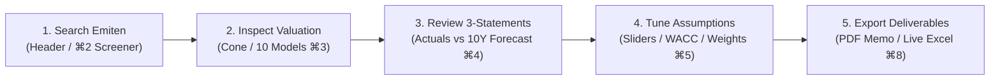
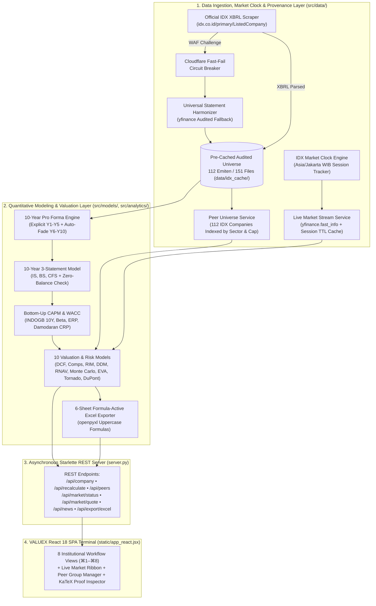

# 🏛️ VALUEX | Institutional Digital Business Valuation Platform
### MM6026 Digital Business Valuation — Master of Business Administration (MBA)
**School of Business and Management, Institut Teknologi Bandung (SBM ITB)**  
*Engineered for Indonesian Equities Listed on the Indonesia Stock Exchange (IDX)*

[](https://celeebi-valuex.hf.space)
[](https://www.python.org/)
[](tests/)
[](data/idx_cache/)
[](src/data/market_clock.py)
[](LICENSE)

---

> ### 🌐 Try VALUEX Instantly in Your Browser (Zero Installation Required)
> You do not need to install anything locally to explore the platform. Launch the live cloud deployment hosted on **Hugging Face Spaces**:
>
> 👉 **Live Application**: **[https://celeebi-valuex.hf.space](https://celeebi-valuex.hf.space)**  
> 📦 **Hugging Face Space Repository**: **[huggingface.co/spaces/celeebi/valuex](https://huggingface.co/spaces/celeebi/valuex)**

---

## 📑 Table of Contents
1. [Introduction & Executive Overview](#-introduction--executive-overview)
2. [What VALUEX Is Capable Of (Core Features)](#-what-valuex-is-capable-of-core-features)
3. [Quick Start: Cloud Access & Local Installation](#-quick-start-cloud-access--local-installation)
4. [How to Use: 5-Step Analyst Workflow](#-how-to-use-5-step-analyst-workflow)
5. [The 8 Institutional Workflow Tabs](#-the-8-institutional-workflow-tabs)
6. [Deep-Dive: Analytical & Modeling Capabilities](#-deep-dive-analytical--modeling-capabilities)
7. [System Architecture & Data Pipeline](#-system-architecture--data-pipeline)
8. [Pre-Cached 112 IDX Universe Breakdown](#-pre-cached-112-idx-universe-breakdown)
9. [Repository Structure](#-repository-structure)
10. [Git Branching & Release Milestones](#-git-branching--release-milestones)
11. [Author Profile & Engineering Pedigree](#-author-profile--engineering-pedigree)
12. [License, Academic AI Disclosure & Disclaimer](#-license-academic-ai-disclosure--disclaimer)

---

## 🌟 Introduction & Executive Overview

**VALUEX** is an institutional-grade corporate finance, equity research, multi-model valuation triangulation, and 10-year 3-statement financial modeling platform engineered specifically for non-financial companies listed on the **Indonesia Stock Exchange (IDX)**.

Developed as a flagship project for **MM6026 Digital Business Valuation** at **SBM ITB**, VALUEX bridges the gap between static academic spreadsheets and professional Bloomberg/Refinitiv-style equity research terminals. Every figure displayed on screen is computed by deterministic, textbook-reconciled pure-Python mathematical engines—with **zero mock placeholders, zero runtime LLM hallucinations, and 100% accounting identity compliance**.

### Why VALUEX Stands Out
- **Search-First Universal Terminal**: Starts in a clean discovery workspace where analysts can search and ingest any IDX-listed non-financial company on demand (`ANTM`, `PWON`, `ASII`, `TLKM`, `ICBP`, `ADRO`, `UNVR`, `KLBF`, etc.).
- **Pre-Cached 112-Company Audited Universe**: Ships with **112 top IDX non-financial equities across 11 sectors** pre-cached from official audited filings, delivering **~5ms load latency** out of the box.
- **Authentic Real-Life Market Feed & IDX Session Clock**: Synchronizes live market quotes via Yahoo Finance (`yfinance.fast_info`) paired with an institutional **Jakarta Time (`Asia/Jakarta`, UTC+7) Market Clock**—updating dynamically during official IDX trading hours and deterministically freezing at the official closing price on weekends and after-hours.
- **Automated & Flexible Relative Valuation Engine**: Automatically discovers comparable IDX peers by sector and market-cap proximity, while allowing analysts to add/remove custom peers, switch statistical benchmarks (`Median`, `Mean`, `Harmonic Mean`, `25th Percentile`), and adjust multiple weights in real time.
- **Zero Node.js / Zero npm Architecture**: Combines an asynchronous **Python Starlette/Uvicorn backend** with a self-contained **React 18 Single-Page Application (SPA)** that compiles natively in the browser via CDN.

---

## ⚡ What VALUEX Is Capable Of (Core Features)

| Capability Pillar | What It Does | Key Highlights |
| :--- | :--- | :--- |
| **1. Real-Life IDX Market Feed & Session Clock** | Tracks official IDX trading sessions in Jakarta Time (`WIB / UTC+7`) and syncs real market quotes. | Live 20s polling during **Session 1** & **Session 2** (`● IDX LIVE (15M)`); strict close freeze during **Lunch Break**, **After-Hours**, and **Weekends** (`● MARKET CLOSED`), plus an optional **Classroom Demo Simulator** (`DEMO SIM ON/OFF`). |
| **2. Automated & Custom Peer Comps Engine** | Eliminates static peer placeholders by indexing all 112 IDX companies by sector and size. | Instant peer auto-selection + interactive **Peer Group Manager** to add/remove any IDX ticker, toggle `Median` / `Average` / `Harmonic Mean` / `25th Percentile`, and re-weight `EV/EBITDA`, `P/E`, and `P/B`. |
| **3. 10 Valuation & Risk Methodologies** | Computes intrinsic fair value across fundamental, asset-based, and stochastic frameworks. | **Multi-Stage FCFF DCF**, **Relative Comps**, **Residual Income (RIM)**, **Dividend Discount (DDM)**, **Property RNAV**, **10,000-Run Monte Carlo (VaR 95%)**, **Stern Stewart EVA® & MVA**, **5x5 WACC/$g$ Matrix**, **Tornado Sensitivity**, and **5-Stage DuPont ROE**. |
| **4. Dynamic 10-Year 3-Statement Model** | Full mathematical articulation across Income Statement, Balance Sheet, and Cash Flow Statement. | Toggle between **10-Year Forecast (2026E–2035E)** and **Audited Actuals (2021A–2025A)** with verified **Zero-Balance Check** ($\text{Assets} \equiv \text{Liabilities} + \text{Equity}, \text{Discrepancy} = 0.00$). |
| **5. Explicit Data Provenance & Banking Guard** | Guarantees institutional data transparency and corporate finance methodology boundaries. | Badges explicitly mark `SOURCE: IDX.CO.ID (XBRL)` vs `SOURCE: YAHOO FINANCE`. Searching commercial banks (`BBCA`, `BBRI`, `BMRI`) triggers an educational **Banking ALM Scope Guard**. |
| **6. Live KaTeX Proofs & Active Excel Export** | Exposes every underlying formula and exports institutional deliverables. | Slide-out **KaTeX Mathematical Inspector** with substituted numbers + **6-Sheet Formula-Active Excel Exporter (`.xlsx`)** with live uppercase Excel formulas (`=SUM()`, `=NPV()`). |

---

## 🚀 Quick Start: Cloud Access & Local Installation

### Option 1: Instant Cloud Terminal (Recommended — 0 Seconds)
Simply open **[https://celeebi-valuex.hf.space](https://celeebi-valuex.hf.space)** in any modern desktop or mobile web browser. All 112 pre-cached IDX companies, live Yahoo Finance quotes, and valuation models are ready to use immediately.

---

### Option 2: 1-Click Local Launch (Windows — Under 60 Seconds)
**Prerequisites**: **Python 3.10+** installed (zero Node.js or npm required).

Double-click [`run_app.bat`](run_app.bat) in the project root folder. The automated launcher will:
1. Detect or create a local Python virtual environment (`.venv`).
2. Install all required packages from [`requirements.txt`](requirements.txt).
3. Start the asynchronous Starlette valuation server at **`http://localhost:8000`**.
4. Automatically open the VALUEX Terminal in your default browser.

---

### Option 3: Command-Line Installation (Windows / macOS / Linux)

```bash
# 1. Clone the repository
git clone https://github.com/celeebi/DBV_Midterm.git
cd DBV_Midterm

# 2. Check out the active production branch
git checkout Valuex-v1.2

# 3. Create and activate a Python virtual environment
python -m venv .venv

# Activate on Windows PowerShell:
.\.venv\Scripts\Activate.ps1
# Activate on macOS / Linux:
source .venv/bin/activate

# 4. Install Python dependencies
pip install -r requirements.txt

# 5. Launch the VALUEX Terminal server (Port 8000)
python server.py
```

Then navigate to **`http://localhost:8000`** in your browser.  
*(Optional Companion UI)*: Run `streamlit run app.py` to launch the auxiliary Streamlit dashboard at `http://localhost:8501`.

### Verifying Your Local Setup (Automated Test Suite)
Run the comprehensive `pytest` suite covering all valuation models, market clock sessions, peer discovery, balance sheet identities, and REST API endpoints:

```bash
pytest -v
```

---

## 💡 How to Use: 5-Step Analyst Workflow



1. **Step 1 — Search or Select an Indonesian Emiten**:
   - Use the top search bar or open **`⌘2 Screener`** and type any IDX ticker (e.g., `ANTM`, `PWON`, `TLKM`, `ASII`, `ICBP`, `INDF`, `UNVR`, `ADRO`).
   - Pre-cached companies load in **~5 milliseconds**; uncached tickers are harmonized on the fly from audited filings.
2. **Step 2 — Analyze Multi-Model Valuation & Customize Peers**:
   - Open **`⌘3 Valuation`** to inspect the **12-Month Target Price Cone** ($\text{Bear} < \text{Base} < \text{Bull}$) or toggle to the **Valuation Methodology Football Field**.
   - Explore the **10 Methodology Sub-Tabs** below the chart. In **Tab 2 (Relative Comps)**, customize your peer group from the 112-company catalog and switch between `Median`, `Mean`, `Harmonic Mean`, or `25th Percentile`.
3. **Step 3 — Audit the 10-Year 3-Statement Model**:
   - Open **`⌘4 3-Statement Model`** to inspect the articulated Balance Sheet, Income Statement, Cash Flow Statement, and Operational Drivers.
   - Toggle `🏛️ Show Historical Actuals` to compare **2021A–2025A audited filings** against **2026E–2035E pro forma projections**, and verify the green `ZERO-BALANCE: ASSETS ≡ LIAB + EQUITY` badge.
4. **Step 4 — Calibrate Growth, WACC & Triangulation Weights**:
   - Open **`⌘5 Assumptions`** to tune Phase 1 High-Growth (Y1–Y5) and Phase 2 Fade (Y6–Y10) sliders, or click **⚡ Auto-Fade (Y6–Y10)**.
   - Adjust the **Fundamental CAPM Modeler** ($\beta$, $R_f$, Mature ERP, Damodaran CRP, $K_d$, $W_d$) and the **Interactive SVG Weight Donut**, then click **⚡ Recalculate Pro Forma**.
5. **Step 5 — Export Institutional Reports**:
   - Open **`⌘8 Tear Sheet`** to print a formatted **Investment Banking Equity Research PDF** or click **📊 Download Excel Model (.xlsx)** to generate a 6-sheet workbook with live Excel formulas.

---

## 🖥️ The 8 Institutional Workflow Tabs

| Shortcut | Workspace View | Primary Purpose & Analytical Tools |
| :---: | :--- | :--- |
| **Top Bar** | **Live Market Ribbon & Beacon** | Displays real-time IDX session status (`● IDX LIVE (15M)` vs `● MARKET CLOSED`), Jakarta clock (`WIB`), ticker marquee, breaking news sentiment wire, and the `DEMO SIM ON/OFF` classroom toggle. |
| **`⌘1`** | **Executive Dashboard** | Coverage universe overview, market dislocation bar chart (Price vs. Composite Fair Value), and BUY/HOLD/SELL signal distribution. |
| **`⌘2`** | **Company Screener** | Universal IDX ticker search, sector filtering, upside/market-cap sorting, and quick discovery pills. |
| **`⌘3`** | **Valuation Workspace** | Interactive Target Price Cone / Football Field toggle + **10 deep-dive methodology sub-tabs** (DCF, Peer Comps, RIM, DDM, RNAV, Monte Carlo, EVA®, WACC Matrix, Tornado/DuPont, KaTeX Proofs). |
| **`⌘4`** | **3-Statement Model** | 10-year articulated Income Statement, Balance Sheet, Cash Flow Statement, historical actuals toggle, data provenance badges, and zero-balance verification. |
| **`⌘5`** | **Model Assumptions** | 10-year explicit growth/margin sliders, linear auto-fade helper, bottom-up CAPM/WACC calculator, Damodaran sanity alerts, and interactive triangulation weight donut. |
| **`⌘6`** | **Order Ticket (EMS)** | Investment thesis builder, catalyst tracker, committee parameters, and simulated **IDX 100-share lot** order execution preview. |
| **`⌘7`** | **Watchlist & Comps** | Side-by-side multi-company fundamental watchlist comparing valuation multiples, margins, ROE, and implied upside. |
| **`⌘8`** | **Research Tear Sheet** | Print-ready equity research tear sheet (`@media print` PDF export) and 1-click **6-Sheet Formula-Active Excel Model (`.xlsx`)** download. |
| **`⌘9` / `⌘0`** | **About & Contact Desk** | MM6026 SBM ITB academic documentation, methodology architecture, author biography, and research inquiry generator. |
| **`🔍`** | **KaTeX Proof Inspector** | Persistent slide-out drawer rendering step-by-step substituted LaTeX mathematical derivations from anywhere in the terminal. |

---

## 📐 Deep-Dive: Analytical & Modeling Capabilities

### 1. Real-Life Yahoo Finance Feed & IDX Trading Session Clock
Located in [`src/data/market_clock.py`](src/data/market_clock.py) and [`src/data/market_stream.py`](src/data/market_stream.py):
- **Jakarta Timezone Engine (`Asia/Jakarta`, UTC+7)**: Evaluates official Indonesia Stock Exchange trading hours:
  - **Monday – Thursday**: Session 1 (`09:00–12:00 WIB`), Lunch Break (`12:00–13:30 WIB`), Session 2 (`13:30–15:50 WIB`), Closing Auction (`15:50–16:15 WIB`), After-Hours (`16:15–08:45 WIB`).
  - **Friday**: Session 1 (`09:00–11:30 WIB`), Friday Mid-Day Break (`11:30–14:00 WIB`), Session 2 (`14:00–15:50 WIB`).
  - **Saturday – Sunday**: Weekend Market Closed.
- **Session-Aware TTL Caching**: Uses a 20-second cache TTL during live trading hours to reflect genuine market movements without hitting API rate limits, and switches to a 300-second cache TTL when the market is closed so Friday's official closing price remains rock-solid.

### 2. Automated & Flexible Relative Valuation Peer Engine
Located in [`src/data/peers.py`](src/data/peers.py) and [`src/models/multiples.py`](src/models/multiples.py):
- Indexes all **112 pre-cached IDX companies** with pre-computed fundamental multiples (`EV/EBITDA`, `P/E`, `P/B`), ROE, EBITDA margin, and market cap in ~17ms.
- Automatically recommends the 4 closest industry peers by sector taxonomy and log-market-cap proximity.
- Supports 4 statistical aggregation methods: **Median** (outlier-resistant default), **Mean (Average)**, **Harmonic Mean** (institutional CFA standard for price ratios), and **25th Percentile** (conservative valuation).

### 3. Multi-Stage FCFF DCF & Fundamental CAPM Modeler
Located in [`src/models/dcf.py`](src/models/dcf.py), [`src/models/pro_forma.py`](src/models/pro_forma.py), and [`src/models/parameters.py`](src/models/parameters.py):
- **10-Year Explicit FCFF Roll-Forward**:
  $$\text{FCFF}_t = \text{EBIT}_t(1 - \tau) + \text{D\&A}_t - \text{CapEx}_t - \Delta\text{NWC}_t$$
- **Bottom-Up WACC**: Incorporates Bank Indonesia 10Y Government Bond Yield ($R_f = 6.60\%$), 5-year Beta ($\beta$), Mature Market ERP ($5.00\%$), Damodaran Indonesia Country Risk Premium ($2.16\%$), and after-tax Cost of Debt.
- **Dual Terminal Value**: Computes both Gordon Growth ($\text{TV} = \frac{\text{FCFF}_{10}(1+g)}{\text{WACC}-g}$) and Exit EV/EBITDA Multiple methods.

### 4. Dynamic 10-Year 3-Statement Financial Model
Located in [`src/models/three_statement.py`](src/models/three_statement.py):
- Links the Income Statement, Balance Sheet, and Cash Flow Statement across 10 forecast years.
- Enforces the strict accounting identity across every historical and projected period:
  $$\text{Total Assets}_t - (\text{Total Liabilities}_t + \text{Total Equity}_t + \text{Minority Interest}_t) \equiv 0.00$$

### 5. Specialized Valuation & Risk Engines
- **Residual Income Model (`src/models/rim.py`)**: Clean-surplus valuation anchored on book value plus discounted excess ROE spreads: $\text{RI}_t = (\text{ROE}_t - K_e) \times B_{t-1}$.
- **Multi-Stage DDM (`src/models/ddm.py`)**: 10-year explicit dividend cash flows discounted at Cost of Equity ($K_e$).
- **Property RNAV (`src/models/rnav.py`)**: Direct capitalization of retail/hotel Net Operating Income (NOI), undeveloped land bank mark-to-market ($\text{IDR/m}^2$), and holding company conglomerate discounts.
- **10,000-Run Vectorized Monte Carlo (`src/models/monte_carlo.py`)**: Correlated normal/triangular sampling of revenue growth, EBITDA margin, WACC, and terminal growth, outputting P10/P50/P90 percentiles, probability of undervaluation, and 95% Value at Risk (VaR).
- **Stern Stewart EVA® & MVA (`src/models/eva.py`)**: $\text{EVA}_t = \text{NOPAT}_t - (\text{WACC} \times \text{Invested Capital}_{t-1})$.
- **Tornado & 5-Stage DuPont ROE (`src/analytics/tornado.py`, `src/analytics/dupont.py`)**: Ranks two-sided $\pm 100\text{ bps}$ parameter swings and decomposes ROE into Tax Burden, Interest Burden, EBIT Margin, Asset Turnover, and Leverage.

### 6. Corporate Finance Scope vs. Banking ALM Guard
Located in [`src/data/loader.py`](src/data/loader.py):
- Commercial banks (`BBCA`, `BBRI`, `BMRI`, `BBNI`, etc.) use customer deposits and debt as operational raw materials rather than capital structure financing, making Enterprise Value (EV), EBITDA, and FCFF inapplicable. Searching a bank ticker triggers a dedicated educational modal explaining why banks require regulatory Asset-Liability Management (ALM) and Basel III / OJK Capital Adequacy Ratio (CAR) models, while offering 1-click non-financial alternatives.

---

## 🏛️ System Architecture & Data Pipeline



---

## 📊 Pre-Cached 112 IDX Universe Breakdown

The repository ships with **112 pre-cached, audited non-financial equities** in [`data/idx_cache/`](data/idx_cache/) across **11 sectors**, providing instant ~5ms loading and automatic peer benchmarking:

| Sector | Count | Pre-Cached IDX Tickers |
| :--- | :---: | :--- |
| **Consumer Staples** | 24 | `ICBP`, `INDF`, `UNVR`, `KLBF`, `MYOR`, `CPIN`, `JPFA`, `CMRY`, `AMRT`, `MIDI`, `GGRM`, `HMSP`, `WIIM`, `ROTI`, `ULTJ`, `CLEO`, `STTP`, `AALI`, `LSIP`, `SIMP`, `DSNG`, `TAPG`, `SSMS`, `TBLA` |
| **Energy, Coal, Oil & Gas** | 18 | `ADRO`, `PTBA`, `ITMG`, `MEDC`, `AKRA`, `PGAS`, `HRUM`, `ESSA`, `INDY`, `BUMI`, `DOID`, `ENRG`, `ELSA`, `PGEO`, `BREN`, `MBMA`, `ARKO`, `RAJA` |
| **Real Estate & Construction** | 12 | `PWON`, `BSDE`, `CTRA`, `SMRA`, `ASRI`, `SSIA`, `DMAS`, `DILD`, `PTPP`, `WIKA`, `ADHI`, `TOTL` |
| **Telecommunications & Tech** | 12 | `TLKM`, `ISAT`, `EXCL`, `TOWR`, `TBIG`, `MTEL`, `GOTO`, `BUKA`, `MTDL`, `EMTK`, `SCMA`, `MNCN` |
| **Basic Materials, Cement & Paper** | 9 | `BRPT`, `TPIA`, `INTP`, `SMGR`, `INKP`, `TKIM`, `AVIA`, `AMMN`, `SMBR` |
| **Healthcare, Pharma & Hospitals** | 7 | `MIKA`, `HEAL`, `SILO`, `TSPC`, `PRDA`, `SAME`, `SIDO` |
| **Mining & Metals** | 7 | `ANTM`, `INCO`, `MDKA`, `TINS`, `NCKL`, `CITA`, `PSAB` |
| **Consumer Discretionary & Retail** | 7 | `ACES`, `MAPI`, `MAPA`, `MAPB`, `ERAA`, `RALS`, `LPPF` |
| **Industrials & Heavy Equipment** | 6 | `ASII`, `UNTR`, `AUTO`, `HEXA`, `DRMA`, `SMSM` |
| **Logistics, Shipping & Transport** | 5 | `BIRD`, `SMDR`, `ASSA`, `TMAS`, `PSSI` |
| **Infrastructure & Utilities** | 5 | `JSMR`, `POWR`, `KEEN`, `AADI`, `MLBI` |
| **Total Audited Universe** | **112** | **100% Audited Filings • Zero Balance Sheet Discrepancy • Instant Load (~5ms)** |

---

## 📁 Repository Structure

```text
Project BA/
├── run_app.bat                           # 1-Click Windows launcher (Starlette server @ localhost:8000)
├── create_desktop_shortcut.bat           # Windows desktop shortcut generator
├── server.py                             # Asynchronous Starlette/Uvicorn REST API server
├── app.py                                # Companion Streamlit analytics interface
├── requirements.txt                      # Python dependencies
├── README.md                             # Flagship project documentation
├── USER_GUIDE.md                         # End-to-end terminal user manual
├── AI_DISCLOSURE.md                      # Academic AI disclosure & verification statement
├── LICENSE                               # MIT License
├── data/
│   └── idx_cache/                        # 151 pre-cached audited statement files (112 IDX equities)
├── scripts/
│   └── precache_universe.py              # Batch pre-caching utility for IDX universe
├── static/
│   ├── img/                              # SBM ITB & MM6026 institutional logos
│   ├── index.html                        # React 18 production shell (Tailwind CDN, Lucide, KaTeX)
│   ├── app_react.jsx                     # VALUEX SPA Terminal (8 views, Live Clock, Peer Manager, 10 subtabs)
│   └── coverage_data.js                  # Initial baseline universe metadata
├── src/
│   ├── data/
│   │   ├── market_clock.py               # IDX Jakarta Time (WIB / UTC+7) trading session clock engine
│   │   ├── market_stream.py              # Real-life Yahoo Finance quote service with session-aware TTL cache
│   │   ├── peers.py                      # Automated 112-company IDX peer discovery & multiple service
│   │   ├── news_service.py               # Live financial news aggregator & sentiment classifier
│   │   ├── loader.py                     # Universal statement harmonizer & banking ALM scope guard
│   │   ├── coverage.py                   # Sector coverage metadata & calibrated defaults
│   │   ├── country_data.py               # Indonesian macro parameters (INDOGB 10Y, BI-Rate, CRP, Tax)
│   │   └── adapters/
│   │       ├── idx_adapter.py            # Official IDX XBRL adapter, cache router & FX converter
│   │       └── idx_scraper/              # Multi-year IDX XBRL financial statement scraper
│   ├── models/
│   │   ├── three_statement.py            # Dynamic 10-year 3-statement model with zero-balance check
│   │   ├── pro_forma.py                  # 10-year pro forma roll-forward & linear auto-fade engine
│   │   ├── parameters.py                 # Bottom-up CAPM & WACC capital structure modeler
│   │   ├── dcf.py                        # Multi-stage FCFF DCF engine (Gordon Growth & Exit Multiple)
│   │   ├── multiples.py                  # Flexible peer relative valuation (Median, Mean, Harmonic, P25)
│   │   ├── rim.py                        # Residual Income Model (Clean Surplus ROE spread)
│   │   ├── ddm.py                        # Multi-stage Dividend Discount Model
│   │   ├── rnav.py                       # Revalued Net Asset Value (NOI cap + Land Bank MTM)
│   │   ├── monte_carlo.py                # 10,000-run vectorized Monte Carlo simulation & 95% VaR
│   │   ├── eva.py                        # Stern Stewart Economic Value Added (EVA®) & MVA engine
│   │   ├── ensemble.py                   # Multi-model valuation triangulation aggregator
│   │   └── scenarios.py                  # Strictly monotonic Bear / Base / Bull scenario forecaster
│   ├── rules/
│   │   ├── sanity_checks.py              # Damodaran boundary guardrails (g < GDP, WACC constraints)
│   │   └── recommendations.py            # Margin-of-safety recommendation engine (BUY / HOLD / SELL)
│   └── analytics/
│       ├── tornado.py                    # Two-sided parameter sensitivity swing ranking
│       ├── dupont.py                     # 5-stage DuPont ROE decomposition
│       ├── exporter.py                   # Formula-active 6-sheet Microsoft Excel exporter (.xlsx)
│       ├── audit_trail.py                # Step-by-step KaTeX LaTeX mathematical proof generator
│       └── sensitivity.py                # 2D WACC vs. terminal growth sensitivity matrix
└── tests/                                # 118 automated unit & integration tests across 16 test modules
    ├── test_market_clock.py              # Jakarta timezone & IDX session transition tests
    ├── test_market_stream.py             # Live Yahoo Finance quote caching & fallback tests
    ├── test_server_market_api.py         # /api/market/status and /api/market/quote endpoint tests
    ├── test_peers.py                     # PeerUniverseService & statistical benchmark tests
    ├── test_audited_historical_statements.py # Multi-company accounting identity & linearity tests
    ├── test_news_service.py              # Live news ingestion & sentiment classification tests
    ├── test_dcf_and_exporter.py          # DCF discounting math & formula-active Excel export tests
    ├── test_three_statement.py           # 10-year 3-statement articulation & zero-balance tests
    ├── test_rnav.py                      # RNAV property valuation tests
    ├── test_monte_carlo.py               # 10,000-run Monte Carlo reproducibility & VaR tests
    ├── test_eva.py                       # EVA & MVA mathematical identity tests
    ├── test_analytics_advanced.py        # Tornado sensitivity & 5-stage DuPont ROE tests
    └── test_api_endpoints.py             # Full Starlette REST API & assumption parity tests
```

---

## 🛡️ Git Branching & Release Milestones

| Branch / Tag | Status | Key Capabilities Included |
| :--- | :--- | :--- |
| **`Valuex-v1.2`** ⭐ | **Active Production** | Live Hugging Face Cloud sync, real-life Yahoo Finance market feed + IDX session clock, automated & custom 112-company peer comps engine, Search-First terminal, explicit data provenance badges, and 118 automated tests. |
| **`Valuex-v1.1`** | **Milestone Release** | Expanded 10-year pro forma 3-statement model, formula-active Excel assumption parity, RNAV, 10,000-run Monte Carlo, and EVA® engine. |
| **`Valuex-v1.0`** | **Foundation Release** | Core 4-way valuation models (DCF, Comps, RIM, DDM), baseline Excel exporter, and modular Python architecture. |

---

## 👤 Author Profile & Engineering Pedigree

The **VALUEX Institutional Digital Business Valuation Platform** was conceptualized, architected, and calibrated by:

### **Ahmad Farhan (Abas)**
*B.Eng. in Engineering Physics (ITS) • MBA Candidate in Finance (SBM ITB)*

Operating at the intersection of quantitative physical systems engineering and institutional corporate finance, Ahmad Farhan engineered VALUEX to transform theoretical valuation methodologies—multi-stage discounted cash flows, clean-surplus residual income, stochastic Monte Carlo simulations, and 10-year articulated financial statements—into an interactive, transparent, and auditable decision-support terminal for equity analysts, finance practitioners, and business school researchers.

#### 🔗 Connect & Research Channels
- **LinkedIn**: [linkedin.com/in/afenterprisefarhan](https://www.linkedin.com/in/afenterprisefarhan)
- **GitHub**: [@celeebi (github.com/celeebi)](https://github.com/celeebi)
- **Hugging Face**: [huggingface.co/celeebi](https://huggingface.co/celeebi) • [Live VALUEX Space](https://celeebi-valuex.hf.space)
- **Instagram**: [@abas.space (instagram.com/abas.space)](https://instagram.com/abas.space)
- **Personal Email**: [`afenterprisefarhan@gmail.com`](mailto:afenterprisefarhan@gmail.com)
- **University Email**: [`29125329@mahasiswa.itb.ac.id`](mailto:29125329@mahasiswa.itb.ac.id)
- **Institution**: School of Business and Management, Institut Teknologi Bandung (SBM ITB), Jl. Ganesha No. 10, Bandung, West Java, Indonesia.

---

## 📄 License, Academic AI Disclosure & Disclaimer

### 1. Open-Source License (MIT)
This project is licensed under the **MIT License**. Permission is hereby granted, free of charge, to any person obtaining a copy of this software and associated documentation files to deal in the Software without restriction, subject to the conditions in the [`LICENSE`](LICENSE) file.

### 2. Academic AI Disclosure & Deterministic Integrity
Developed for **MM6026 Digital Business Valuation** at **SBM ITB**. In full compliance with academic transparency standards:
- **Pair-Programming & Scaffolding**: AI coding assistance (Google DeepMind Antigravity) was utilized to accelerate UI scaffolding, data normalization pipelines, and automated unit test generation.
- **100% Deterministic Financial Math**: **Zero black-box LLM APIs are invoked at runtime for financial calculations**. Every WACC, FCFF, terminal value, peer multiple, balance sheet roll-forward, and Monte Carlo simulation is executed by deterministic Python code reconciled against *Damodaran on Valuation* and *McKinsey Valuation*, and verified by the Calculation Inspector and `pytest` suite.
- For the full breakdown of human analyst ownership versus AI scaffolding, see [`AI_DISCLOSURE.md`](AI_DISCLOSURE.md).

### 3. Institutional & Educational Disclaimer
*All financial models, intrinsic value estimates, scenario cones, and BUY/HOLD/SELL signals generated by VALUEX are strictly for **academic research and educational demonstration purposes** within the Master of Business Administration (MBA) curriculum at SBM ITB. Nothing in this software constitutes licensed investment advice or a solicitation to buy or sell securities on the Indonesia Stock Exchange (IDX).*
