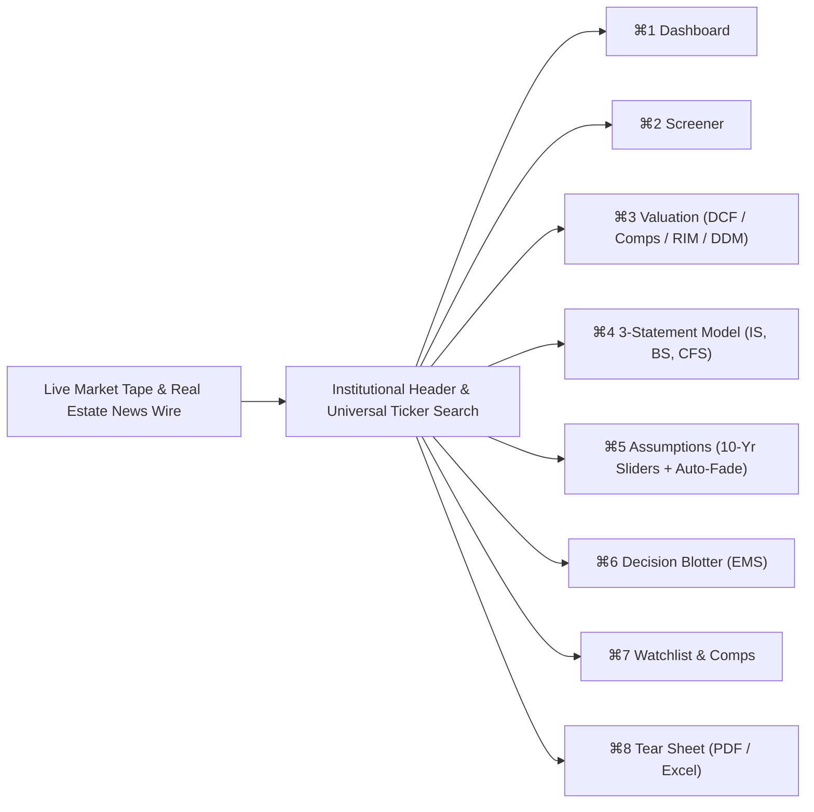

# 🏛️ VALUEX | Institutional Digital Business Valuation Platform
### MM6026 Digital Business Valuation — Highest-Score Implementation Tier
**Calibrated to IDX:PWON (PT Pakuwon Jati Tbk) & Indonesian Property Universe**

[](https://www.python.org/)
[](LICENSE)
[](tests/)
[](src/)
[](https://www.idx.co.id/)
[](https://github.com/celeebi/DBV_Midterm)

An institutional-grade equity research, 4-way valuation triangulation, and 10-year 3-statement financial modeling platform engineered for Indonesian equities listed on the Indonesia Stock Exchange (**IDX**).

The platform pairs a high-performance **Python Starlette/Uvicorn backend** with a **zero-Node.js/npm React 18 frontend** (the **VALUEX Terminal**). Default benchmarked to **PT Pakuwon Jati Tbk (`PWON.JK`)** and its property peers (`BSDE.JK`, `CTRA.JK`, `SMRA.JK`, `ASII.JK`), the system also features **Universal Ticker Search & Live Loading** from IDX/Yahoo Finance (`BBCA`, `TLKM`, `UNVR`, `BMRI`, `ICBP`), full **10-year explicit forecast sliders with auto-fade**, integrated **10-year 3-statement modeling with zero-balance checks** ($\text{Assets} \equiv \text{Liabilities} + \text{Equity}$), and a live **formula-active 6-sheet Microsoft Excel exporter (`.xlsx`)**.

---

## 📑 Table of Contents
- [Executive Overview](#-executive-overview)
- [The 8 Institutional Workflow Tabs](#-the-8-institutional-workflow-tabs)
- [Key Modeling Capabilities](#-key-modeling-capabilities)
  - [1. 4-Way Valuation Triangulation](#1-4-way-valuation-triangulation)
  - [2. Universal Ticker Search & Live Fetcher](#2-universal-ticker-search--live-fetcher)
  - [3. Full 10-Year Explicit Forecasts & Auto-Fade](#3-full-10-year-explicit-forecasts--auto-fade)
  - [4. Integrated 10-Year 3-Statement Financial Model](#4-integrated-10-year-3-statement-financial-model)
  - [5. Simulated Order Blotter & Execution Management](#5-simulated-order-blotter--execution-management)
  - [6. Formula-Active 6-Sheet Microsoft Excel Export](#6-formula-active-6-sheet-microsoft-excel-export)
- [System Architecture](#-system-architecture)
- [Repository Structure](#-repository-structure)
- [Quick Start Guide](#-quick-start-guide)
  - [Prerequisites](#prerequisites)
  - [1-Click Launch (Windows)](#1-click-launch-windows)
  - [Command-Line Execution](#command-line-execution)
  - [Running Automated Unit Tests](#running-automated-unit-tests)
- [Git Branching & Safety Policy](#-git-branching--safety-policy)
- [License & Academic Disclosure](#-license--academic-disclosure)

---

## 🌟 Executive Overview



The VALUEX Terminal implements an end-to-end investment banking equity research workflow. Every metric displayed in the interface is backed by pure-Python mathematical modules, ensuring complete auditability and zero hallucination.

---

## 🖥️ The 8 Institutional Workflow Tabs

1. **Top Live Market Ribbon & Real Estate Wire**:
   - Expanded unclipped real-time ticker tape displaying `PWON.JK` (IDR 270, Intrinsic IDR 575), property peers (`BSDE`, `CTRA`, `SMRA`, `ASII`), and macroeconomic benchmarks: `IHSG (7,785)`, `ID 10Y Yield (6.60%)`, `USD/IDR (15,850)`, `BI 7-Day Repo (6.00%)`, and `IDX Property Index (824.50)`.
   - Live stream toggle (`[● LIVE FEED] / [❚❚ PAUSED]`) with rotating real estate research wire bulletins.
2. **`⌘1` Executive Dashboard**:
   - Coverage market capitalization summary, average universe upside, and recommendation signal distribution.
   - Valuation Dislocation horizontal bar chart with BUY hurdle reference lines (+15%).
   - Direct launch links to valuation models.
3. **`⌘2` Company Screener (Discovery)**:
   - Filter by recommendation signal (`BUY`, `HOLD`, `SELL`) and sort by upside or market cap.
   - **Universal Ticker Search & Ingestion Card**: Input any IDX/global equity (e.g. `BBCA`, `TLKM`, `UNVR`) to pull live audited financials and calculate intrinsic valuation instantly.
4. **`⌘3` Valuation Workspace**:
   - 12M historical market price vs intrinsic target area chart.
   - Valuation Methodology Football Field (DCF, Comps, RIM, DDM, and Composite range) with current price marker.
   - 6 Methodology Sub-Tabs:
     - **Tab 1: Multi-Stage DCF**: 10-year FCFF pro forma schedule + Enterprise-to-Equity bridge.
     - **Tab 2: Property Comps**: EV/EBITDA, P/E, P/B peer matrix with subject comparisons.
     - **Tab 3: Residual Income Model (RIM)**: Book value equity + PV of economic profits schedule.
     - **Tab 4: Dividend Discount Model (DDM)**: 10-year explicit dividend schedule + Gordon Growth terminal value.
     - **Tab 5: 5x5 WACC Sensitivity**: Heatmap matrix across WACC (9.42%–11.42%) vs $g$ (1.0%–2.0%).
     - **Tab 6: KaTeX Mathematical Proofs**: Substituted step-by-step LaTeX formula derivations.
5. **`⌘4` 3-Statement Financial Model**:
   - First-class view showcasing 10-year articulated financial statements (2026E–2035E).
   - Dedicated statement selector: Balance Sheet, Income Statement, and Cash Flow Statement.
   - **Zero-Balance Check Row**: Proves $\text{Assets} - (\text{Liabilities} + \text{Equity}) \equiv \text{IDR } 0.00$ with green checkmark across all 10 periods.
6. **`⌘5` Model Assumptions & Parameter Editor**:
   - **Phase 1: Explicit High Growth (Years 1–5)**: 5 individual sliders/inputs for high-growth explicit period.
   - **Phase 2: Transition & Fade Phase (Years 6–10)**: 5 individual sliders/inputs for transition period.
   - **⚡ Auto-Fade Helper (Y6–Y10)**: Linearly fades Year 5 growth into terminal $g$ ($1.5\%$).
   - **Amateur Financier / Convergence Warning**: Educational alert banner triggered if Year 10 growth is set higher than sustainable GDP ($5.0\%$) or WACC.
   - Operating margin levers, CapEx %, D&A %, NWC intensity, tax rates, and method weighting sliders.
7. **`⌘6` Buy / Sell Decision Workspace**:
   - Investment thesis pillars, catalyst monitoring, and downside risks.
   - Portfolio Committee decision parameters (Entry/Exit targets, holding horizon, analyst memo).
   - **Simulated Order Ticket (EMS Preview)**: Standard **IDX 100-share lot** quantity input, limit price, and gross notional calculation.
8. **`⌘7` Watchlist & Comps Matrix**:
   - Equity watchlist with side-by-side fundamental and multiple comparison matrix.
9. **`⌘8` Research Report Tear Sheet**:
   - Formal investment banking equity research memo format.
   - **"Print / Save PDF"** button (invoking `@media print` clean report layout).
   - **"Download Excel Model (.xlsx)"** button.
10. **Persistent "Inspector 🔍" KaTeX Flyout Drawer**:
    - Accessible from any screen via top header button.
    - Slides out KaTeX LaTeX equations with substituted figures for WACC, Terminal Value, Enterprise Bridge, DDM, and Triangulation.

---

## 📐 Key Modeling Capabilities

### 1. 4-Way Valuation Triangulation
The platform computes four distinct, mathematically verified corporate finance valuation methods:
- **DCF-FCFF**: 10-year explicit unlevered free cash flows discounted at live WACC, cross-checked with dual terminal value (Gordon Growth and EV/EBITDA exit multiple).
- **Property Comps**: Enterprise-based and equity-based multiple benchmarking against Indonesian property peers (`BSDE`, `CTRA`, `SMRA`, `ASRI`, `LPKR`).
- **Residual Income Model (RIM)**: Book value of equity augmented by present value of economic profits (clean surplus accounting).
- **Multi-Stage DDM**: 10-year explicit dividend schedule ($DPS_t = EPS_t \times \text{Payout}$) discounted at Cost of Equity ($K_e$), with Gordon Growth perpetual terminal value.
- **Composite Triangulation**: Configurable percentage weights totaling 100%:
  $$\text{Target Price} = w_{\text{DCF}} P_{\text{DCF}} + w_{\text{Comps}} P_{\text{Comps}} + w_{\text{RIM}} P_{\text{RIM}} + w_{\text{DDM}} P_{\text{DDM}}$$

### 2. Universal Ticker Search & Live Fetcher
In addition to the pre-calibrated `PWON.JK` benchmark and property universe, analysts can type **any** ticker into the header bar or Screener card (e.g. `BBCA.JK`, `TLKM.JK`, `BMRI.JK`, `UNVR.JK`, `ICBP.JK`). The system queries `yfinance`, extracts audited balance sheets, income statements, cash flows, beta, shares, and current prices, normalizes currency units, and integrates the stock directly into the terminal.

### 3. Full 10-Year Explicit Forecasts & Auto-Fade
Rather than truncating the forecast at Year 5, the platform provides explicit controls for all 10 periods:
- **Phase 1 (Years 1–5)**: High-growth operational roll-forward.
- **Phase 2 (Years 6–10)**: Macroeconomic transition & fade.
- **Auto-Fade Helper**: Automatically applies linear interpolation:
  $$\Delta g = \frac{g_5 - g_{\text{terminal}}}{5}, \quad g_t = g_5 - \Delta g \times (t - 5) \quad \text{for } t \in [6, 10]$$
- **Amateur Financier Warning**: Flags a Damodaran boundary error if an analyst attempts to run Year 10 growth above long-term Indonesian GDP ($5.0\%$) into terminal perpetuity.

### 4. Integrated 10-Year 3-Statement Financial Model
Full mathematical articulation across Income Statement, Balance Sheet, and Cash Flow Statement:
- **Balance Sheet Check**: $\text{Assets} - (\text{Liabilities} + \text{Equity}) \equiv \text{IDR } 0.00$ across all 10 forecast years.
- Dynamic Working Capital schedules (DSO = 15 days, DIO = 521 days for property inventories, DPO = 72 days).
- PP&E continuity schedules ($\text{PP\&E}_t = \text{PP\&E}_{t-1} + \text{CapEx}_t - \text{Depr}_t$).

### 5. Simulated Order Blotter & Execution Management
- Institutional Execution Management System (EMS) ticket preview.
- Order sizing in standard **Indonesia Stock Exchange (IDX) 100-share lots** (`1 lot = 100 shares`).
- Limit price input, gross notional value calculation (IDR), and staged order session logging.

### 6. Formula-Active 6-Sheet Microsoft Excel Export
Generates institutional `.xlsx` workbooks via `openpyxl` with dynamic, uppercase Excel formulas:
- **Sheet 1: `Executive Summary`**: Valuation matrix, KPI cards, and methodology football field.
- **Sheet 2: `10Y Pro Forma DCF`**: Explicit FCFF schedules with dynamic Excel formulas (`=B1*(1+B2)`, `=SUM(B3:B10)`).
- **Sheet 3: `3-Statement Model`**: Full 10-year IS, BS, and CFS articulation with live zero-balance check rows.
- **Sheet 4: `Property Comps`**: Peer multiple benchmarks (EV/EBITDA, P/E, P/B).
- **Sheet 5: `RIM & DDM`**: Economic profit schedules, dividend discount schedules, and terminal values.
- **Sheet 6: `Audit & Sensitivity`**: 5x5 WACC vs $g$ sensitivity matrix and LaTeX proof summaries.

---

## 🏛 System Architecture

```
[ yfinance Live Market API / IDX Audited Filings ]
                     ↓
[ FinancialDataLoader & Statement Normalizer (src/data/loader.py) ]
                     ↓
┌─────────────────────────────────────────────────────────────┐
│          10-Year Pro Forma Financial Modeling Engine        │
│          (src/models/pro_forma.py & three_statement.py)     │
└──────────────────────────────┬──────────────────────────────┘
                               ↓
       ┌───────────────────────┼───────────────────────┐
       ↓                       ↓                       ↓
[ Multi-Stage DCF ]    [ Relative Comps ]      [ RIM & DDM Models ]
(src/models/dcf.py)   (src/models/multiples.py) (src/models/rim, ddm.py)
       │                       │                       │
       └───────────────────────┼───────────────────────┘
                               ↓
              [ 4-Way Triangulation & Weighting ]
                   (src/models/ensemble.py)
                               ↓
              [ Margin of Safety Recommendation ]
                 (src/rules/recommendations.py)
                               ↓
              [ Automated Model Sanity Checks ]
                 (src/rules/sanity_checks.py)
                               ↓
       ┌───────────────────────┴───────────────────────┐
       ↓                                               ↓
[ VALUEX React 18 Terminal ]            [ Active Excel Exporter (.xlsx) ]
(Zero Node.js / Python Starlette)          (src/analytics/exporter.py)
```

---

## 📁 Repository Structure

```
Project BA/
├── run_app.bat                     # 1-Click Windows launcher (Starlette server @ localhost:8000)
├── create_desktop_shortcut.bat     # Windows desktop shortcut generator
├── server.py                       # High-performance asynchronous backend server (Starlette/Uvicorn)
├── app.py                          # Companion Streamlit analytical interface
├── requirements.txt                # Python package dependencies
├── README.md                       # Comprehensive institutional project documentation
├── USER_GUIDE.md                   # User guide & operational manual for VALUEX Terminal
├── PLAN.md                         # Architectural design and execution roadmap
├── AI_DISCLOSURE.md                # Academic AI disclosure and verification statement
├── LICENSE                         # MIT License
├── static/
│   ├── index.html                  # React 18 production shell (Tailwind CDN, Lucide, KaTeX, Error Boundary)
│   ├── app_react.jsx               # VALUEX Terminal application (8 workflow views, 10Y sliders, Universal Search)
│   ├── coverage_data.js            # Synchronous initial Indonesian property coverage (PWON, BSDE, CTRA, SMRA, ASII)
│   ├── index_legacy.html           # Verified backup of prior frontend interface
│   ├── app.js                      # Legacy vanilla JS controller
│   └── draft.tsx                   # Original institutional design reference template
├── src/
│   ├── data/
│   │   ├── loader.py               # Live market extractor & statement normalizer
│   │   ├── coverage.py             # Coverage universe data (PWON benchmark + property peers)
│   │   ├── country_data.py         # Indonesian macroeconomic parameters (tax rate, BI 7DRR, 10Y yield)
│   │   └── normalizer.py           # Balance sheet & income statement standardization
│   ├── models/
│   │   ├── dcf.py                  # 10-year FCFF multi-stage DCF engine with dual terminal value
│   │   ├── ddm.py                  # Multi-stage Dividend Discount Model with Gordon Growth TV
│   │   ├── three_statement.py      # Integrated 10-year 3-statement financial model (zero-balance check)
│   │   ├── multiples.py            # Relative valuation comps with peer filtering & median/mean aggregation
│   │   ├── rim.py                  # Residual Income Model (clean surplus ROE - Ke)
│   │   ├── ensemble.py             # 4-way triangulation aggregator
│   │   ├── parameters.py           # CAPM & WACC capital structure model
│   │   ├── pro_forma.py            # 10-year pro forma roll-forward & auto-fade generator
│   │   └── scenarios.py            # Bear / Base / Bull scenario forecaster
│   ├── rules/
│   │   ├── sanity_checks.py        # Academic guardrails (g >= WACC, negative multiples, EV bridge check)
│   │   └── recommendations.py      # Recommendation engine (BUY / HOLD / SELL)
│   └── analytics/
│       ├── exporter.py             # 6-sheet formula-active Excel (.xlsx) exporter
│       ├── audit_trail.py          # LaTeX mathematical proof generator
│       ├── sensitivity.py          # 2D WACC vs g sensitivity matrix
│       └── visualizer.py           # Plotly visualization engine
└── tests/
    ├── test_dcf_and_exporter.py    # DCF discounting math and active formula Excel tests
    ├── test_ddm.py                 # Multi-stage DDM, 4-way triangulation, and Excel export tests
    ├── test_pro_forma.py           # 10-year pro forma roll-forward, WACC, and auto-fade tests
    ├── test_sanity_checks.py       # Terminal growth, negative multiple, and EV bridge tests
    └── test_three_statement.py     # 10-year 3-statement articulation and zero-balance tests
```

---

## 🚀 Quick Start Guide

### Prerequisites
- Python 3.10+ (tested on Python 3.14.7).
- Standard web browser (Edge, Chrome, Firefox, Safari).
- Zero external Node.js, npm, or JavaScript build steps required.

### 1-Click Launch (Windows)
Double-click [`run_app.bat`](file:///c:/Users/Public/Documents/Project%20BA/run_app.bat) in the project folder. It will:
1. Detect or configure your local Python virtual environment (`.venv`).
2. Start the asynchronous Starlette valuation server.
3. Automatically launch your default browser to `http://localhost:8000`.

### Command-Line Execution
```powershell
# Activate local virtual environment
.\.venv\Scripts\Activate.ps1

# Start the VALUEX Terminal server (Port 8000)
python server.py

# Or run the companion Streamlit interface (Port 8501)
streamlit run app.py
```

### Running Automated Unit Tests
To verify all financial engines, 3-statement balance checks, and Excel formula exports:
```powershell
.\.venv\Scripts\pytest.exe -v
```
Expected output: **15 passed in 0.68s** (100% pass rate).

---

## 🛡️ Git Branching & Safety Policy

| Branch / Tag | Description | Commit |
| :--- | :--- | :--- |
| **`develop`** (Active) | Contains the institutional VALUEX Terminal, Universal Ticker Search, expanded live ribbon, and 10-year sliders. | `67dd6d9` |
| **`main`** (Stable) | Untouched stable baseline containing the verified 4-way valuation models and Excel exporter. | `36a99e3` |
| **`v1.0-checkpoint`** (Tag) | Fixed checkpoint tag anchored to `36a99e3` for instant rollback safety. | `36a99e3` |

To switch back to the stable checkpoint at any time:
```powershell
git checkout main
# or
git checkout v1.0-checkpoint
```

---

## 📄 License & Academic Disclosure

- **Course:** MM6026 Digital Business Valuation  
- **License:** MIT License. See [`LICENSE`](file:///c:/Users/Public/Documents/Project%20BA/LICENSE) for terms.  
- **Academic AI Disclosure:** All AI assistance utilized in constructing and verifying this platform complies with institutional academic standards. See [`AI_DISCLOSURE.md`](file:///c:/Users/Public/Documents/Project%20BA/AI_DISCLOSURE.md).
